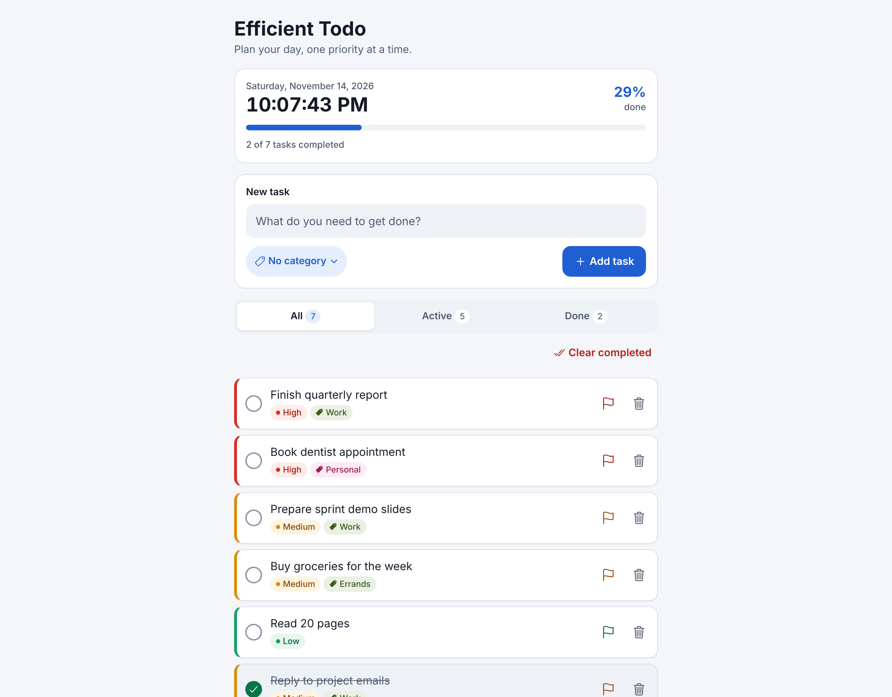
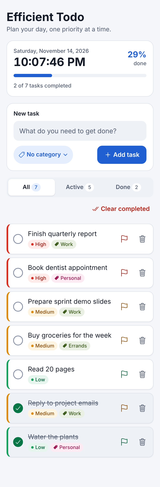
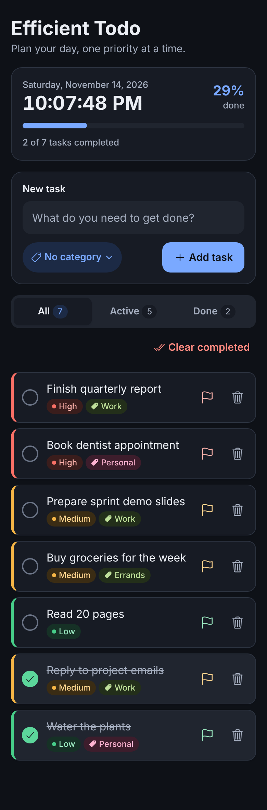
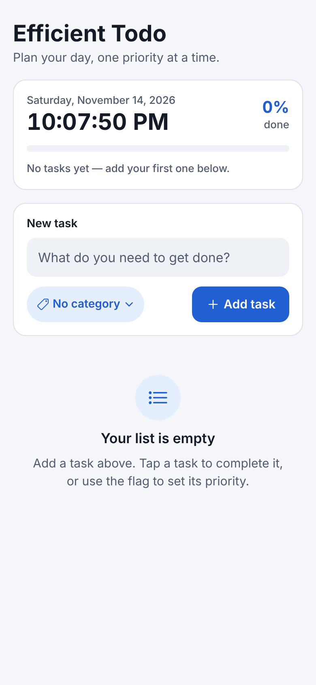
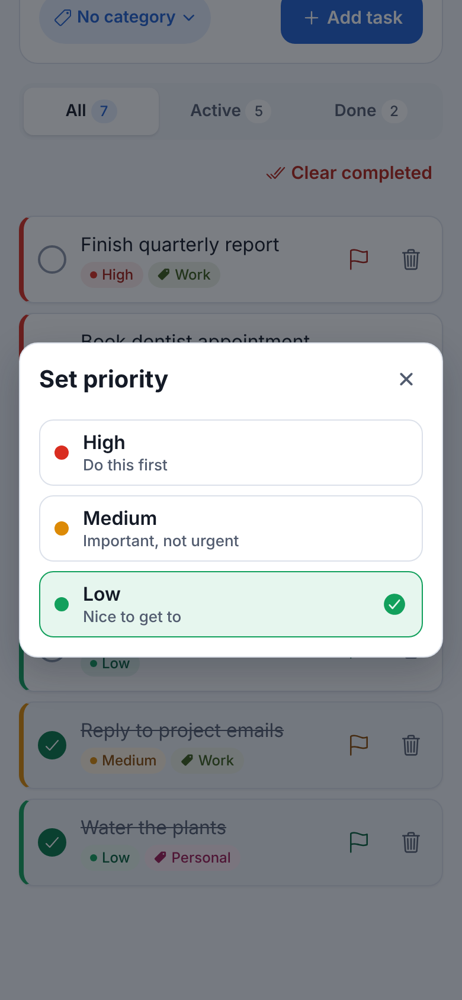
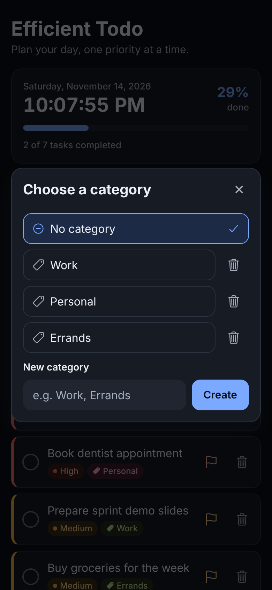
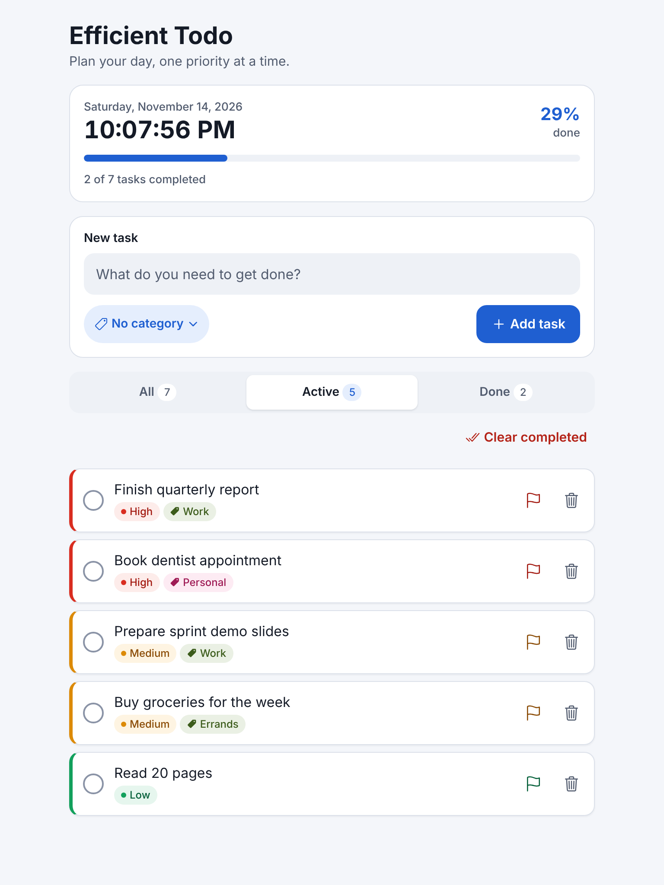
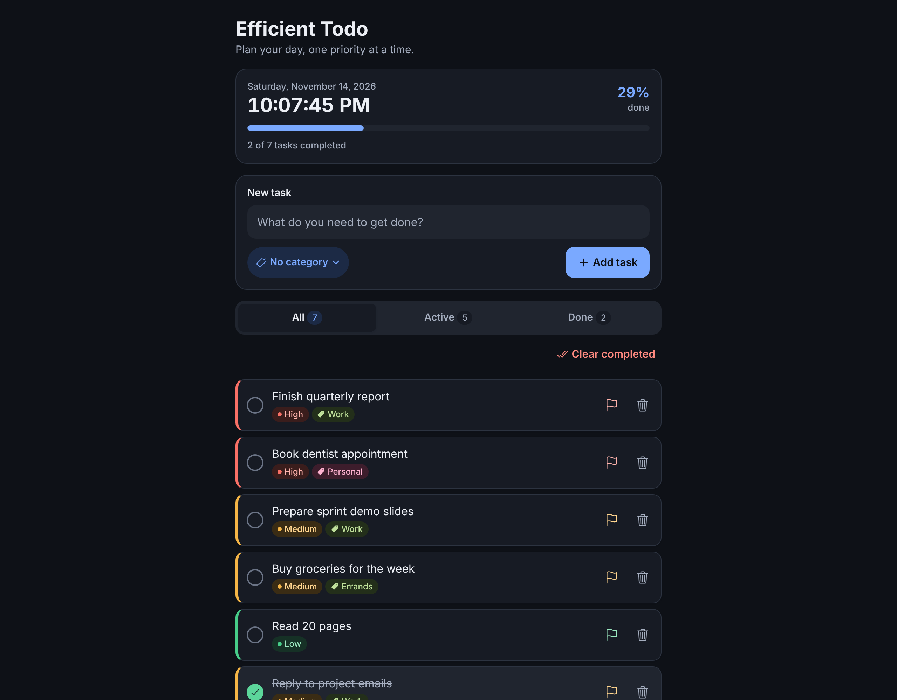
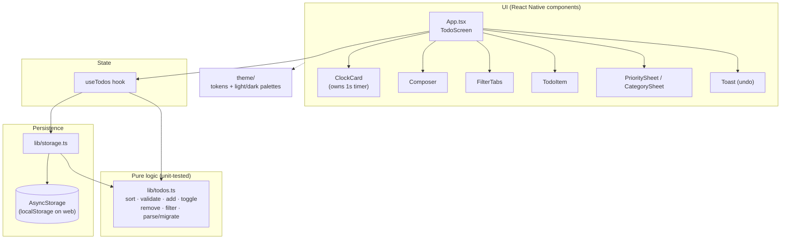

# Efficient Todo

> A fast, offline-first to-do list for iOS, Android and the web: priorities, categories, undo and dark mode, built with Expo and React Native.


<p align="center">
  
</p>

## Overview

Most to-do apps either do too little (a flat list) or too much (accounts, sync, projects, deadlines). **Efficient Todo** sits in between. It is a single screen that helps you decide _what to do next_:

- each task has a **priority** (high, medium, low), and the list keeps itself sorted, so the most important open work is always at the top;
- **categories** group related tasks (Work, Errands, …) with colour-coded tags;
- a **live clock and progress bar** show the day and how much you've done.

There is no sign-up and no server. Everything is stored on the device (AsyncStorage on native, `localStorage` on the web), so it works offline and your data stays with you.

It suits anyone who wants a lightweight personal task list on their phone or in a browser tab. It is also a compact, well-tested example of an Expo + TypeScript app with a small design system, accessibility work and dark mode.

## Screenshots

|                                            Phone: light                                             |                                            Phone: dark                                            |                                      Empty state                                       |
| :-------------------------------------------------------------------------------------------------: | :-----------------------------------------------------------------------------------------------: | :------------------------------------------------------------------------------------: |
|  |  |  |

|                                                      Priority dialog                                                      |                                          Category dialog (dark)                                           |                                         Tablet: "Active" filter                                          |
| :-----------------------------------------------------------------------------------------------------------------------: | :-------------------------------------------------------------------------------------------------------: | :------------------------------------------------------------------------------------------------------: |
|  |  |  |

<details>
<summary>Desktop: dark mode</summary>


</details>

All screenshots are of the web build running locally with demo data.

## Features

- **Add tasks** with inline validation (no empty tasks, 200-character limit with a live counter near the limit).
- **Priorities**: high, medium or low, set from a dialog. Tasks sort automatically: open before done, then by priority, then oldest first.
- **Categories**: create, pick and delete categories. Deleting a category moves its tasks back to "No category". Duplicate names are rejected regardless of letter case.
- **Complete tasks** by tapping them. A long press is a shortcut for delete.
- **Delete with undo**: a toast offers _Undo_ for 5 seconds.
- **Filters**: All, Active and Done tabs with live counts, plus **Clear completed**.
- **Live clock and progress**: the current date and time, the percentage done and a progress bar.
- **Persistence**: data is saved on the device automatically. Records from the original version of the app are migrated, and corrupt data is ignored instead of crashing the app.
- **Loading, empty, error and save-failure states**, including a _Try again_ button if stored data can't be read.
- **Dark mode** that follows the system setting.
- **Accessible**: semantic roles (checkbox, tab, radio, dialog, progressbar), labelled controls, keyboard navigation with visible focus rings on the web, touch targets of at least 44 px, and colour pairs that meet WCAG AA contrast.
- **Responsive**: a single column that stays readable from 375 px phones up to wide desktop screens (content is capped at 640 px wide).

## Tech stack

| Layer        | Technology                                                                                                                             |
| ------------ | -------------------------------------------------------------------------------------------------------------------------------------- |
| Framework    | [Expo](https://expo.dev) SDK 53, [React Native](https://reactnative.dev) 0.79 (New Architecture), React 19                             |
| Language     | TypeScript 5.8 (strict)                                                                                                                |
| Web          | [react-native-web](https://necolas.github.io/react-native-web/) bundled with Metro                                                     |
| Storage      | [`@react-native-async-storage/async-storage`](https://react-native-async-storage.github.io/async-storage/) (`localStorage` on the web) |
| UI           | React Native core components, `@expo/vector-icons` (Ionicons), `react-native-safe-area-context`                                        |
| Testing      | Jest (`jest-expo` preset), React Native Testing Library                                                                                |
| Code quality | ESLint (`eslint-config-expo`), Prettier                                                                                                |

## Architecture

The app is a single screen. All business rules are **pure functions** in `src/lib/todos.ts`, which makes them easy to unit test. A custom hook, `useTodos`, owns the state and writes every change to storage. The components only render.



**Data flow:** a user action calls a `useTodos` method → the method computes the next list with a pure function from `lib/todos.ts` → it updates React state and saves the list in the background. If saving fails, a banner tells the user. On start-up, `loadState()` reads both keys, then validates and migrates them with `parseStoredTodos` / `parseStoredCategories`.

### Data model

```ts
interface Todo {
  id: string; // e.g. "lz3k1x2-8f3k2l1a"
  text: string; // 1–200 chars
  completed: boolean;
  priority: 'high' | 'medium' | 'low';
  category: string; // a category name, or "Uncategorized"
  createdAt: number; // epoch ms, used as a sort tie-breaker
}
```

Storage keys: `todos` (JSON array of `Todo`) and `categories` (JSON array of strings). The keys are the same as in the original version, so existing data still loads.

## Project structure

```
.
├── App.tsx                  # Root: SafeAreaProvider + TodoScreen (composes the whole UI)
├── index.ts                 # Expo entry point (registerRootComponent)
├── app.json                 # Expo config: name, icons, splash, dark mode, web settings
├── public/
│   ├── index.html           # Web HTML template: title, meta description, Open Graph, theme-color
│   └── assets/icon.png      # Icon served for Open Graph / apple-touch-icon
├── assets/                  # App icon, adaptive icon, splash, favicon
├── src/
│   ├── components/          # Presentational components
│   │   ├── Touchable.tsx    #   Pressable with keyboard-only focus ring (base for all controls)
│   │   ├── Button.tsx       #   Primary / secondary / ghost / danger buttons
│   │   ├── IconButton.tsx   #   44×44 icon-only button with required accessible label
│   │   ├── ClockCard.tsx    #   Live clock + progress bar
│   │   ├── Composer.tsx     #   New-task form with validation
│   │   ├── FilterTabs.tsx   #   All / Active / Done segmented tabs
│   │   ├── TodoItem.tsx     #   A task row (checkbox, tags, priority + delete actions)
│   │   ├── Sheet.tsx        #   Modal dialog shell
│   │   ├── PrioritySheet.tsx
│   │   ├── CategorySheet.tsx
│   │   ├── StateView.tsx    #   Loading / empty / error placeholder
│   │   └── Toast.tsx        #   Transient message with optional action (Undo)
│   ├── hooks/
│   │   ├── useTodos.ts      # State + persistence for tasks and categories
│   │   └── useNow.ts        # Ticking clock
│   ├── lib/
│   │   ├── todos.ts         # Pure business logic (sorting, validation, migration…)
│   │   ├── storage.ts       # AsyncStorage read/write
│   │   ├── format.ts        # Date/time/label formatting
│   │   └── __tests__/       # Unit tests for the pure logic
│   ├── theme/index.ts       # Spacing, radius, typography tokens; light & dark palettes; useTheme()
│   └── types/todo.ts        # Todo type, constants (limits, priorities)
├── __tests__/App.test.tsx   # Integration tests that drive the full UI
├── jest.setup.js            # AsyncStorage + safe-area mocks
├── eslint.config.js         # ESLint flat config (Expo + Prettier)
└── .prettierrc.json
```

## Getting started

### Prerequisites

- **Node.js 18.18 or newer** (tested with Node 22) and npm
- To run on a device: the **Expo Go** app ([iOS](https://apps.apple.com/app/expo-go/id982107779) / [Android](https://play.google.com/store/apps/details?id=host.exp.exponent)), or an iOS Simulator (macOS with Xcode) or Android Emulator (Android Studio)
- To run on the web: any modern browser

### Installation

```bash
git clone https://github.com/jeevithg090/Effienct-ToApp.git
cd Effienct-ToApp
npm ci
```

### Run in development

```bash
npm start          # Expo dev server; scan the QR code with Expo Go, or press i / a / w
npm run web        # open straight in the browser
npm run ios        # iOS Simulator (macOS only)
npm run android    # Android emulator or a connected device
```

### Production web build

```bash
npm run build:web  # static export to ./dist
npm run serve:web  # serve ./dist locally at http://localhost:8081
```

`dist/` is a plain static single-page site.

### Configuration

The app needs **no environment variables, API keys or backend**. All configuration is in `app.json`:

| Setting                   | Value            | Purpose                                                   |
| ------------------------- | ---------------- | --------------------------------------------------------- |
| `expo.name`               | `Efficient Todo` | Display name on the home screen and in the browser        |
| `expo.userInterfaceStyle` | `automatic`      | Follows the system light/dark setting                     |
| `expo.web.output`         | `single`         | Exports a single-page app (`index.html` plus a JS bundle) |
| `expo.web.themeColor`     | `#1F5FD1`        | Browser UI colour / PWA manifest colour                   |

To change the page title, meta description or Open Graph tags, edit `public/index.html`.

## Usage

1. **Add a task**: type in **New task** and press <kbd>Enter</kbd> or **Add task**. If you submit an empty task, a message asks you to enter one.
2. **Pick a category** (optional): tap the **No category** chip, then choose an existing category or create one. New tasks use this category until you change it.
3. **Complete a task**: tap it (or focus it and press <kbd>Space</kbd>/<kbd>Enter</kbd> on the web). Completed tasks drop below the open ones and are struck through.
4. **Change priority**: tap the 🏳 flag icon on a task and choose High, Medium or Low.
5. **Delete**: tap the trash icon (or long-press the task), then tap **Undo** within 5 seconds if it was a mistake.
6. **Filter**: switch between **All**, **Active** and **Done**. **Clear completed** removes every finished task.
7. **Manage categories**: open the category dialog and use the trash icon next to a category. Its tasks become uncategorised.

## Scripts

| Command                           | Description                                                     |
| --------------------------------- | --------------------------------------------------------------- |
| `npm start`                       | Start the Expo dev server                                       |
| `npm run web` / `ios` / `android` | Start the dev server and open that platform                     |
| `npm run build:web`               | Export a production web build to `dist/`                        |
| `npm run serve:web`               | Serve `dist/` locally                                           |
| `npm run typecheck`               | Type-check with `tsc --noEmit`                                  |
| `npm run lint`                    | Lint with ESLint                                                |
| `npm run format` / `format:check` | Format with Prettier, or check formatting                       |
| `npm test`                        | Run the Jest test suite                                         |
| `npm run test:coverage`           | Run the tests with a coverage report in `coverage/`             |
| `npm run check`                   | Typecheck + lint + format check + tests (run before committing) |

## Testing

```bash
npm test
npm run test:coverage
```

There are 37 tests in three suites:

- **`src/lib/__tests__/todos.test.ts`**: sorting rules, text and category validation, every list operation, category deletion, colour hashing, and parsing/migration of stored data (legacy records, corrupt JSON, duplicate ids, invalid priorities).
- **`src/lib/__tests__/format.test.ts`**: date, time and label formatting.
- **`__tests__/App.test.tsx`**: integration tests that render the whole app with React Native Testing Library. They cover adding (and saving) tasks, validation messages, toggling, filtering, delete + undo, the priority dialog, creating and deleting categories, clear completed, loading data from a previous session, and the load-error and save-error states.

At the time of writing, line coverage is about 90% overall and 100% of lines in `src/lib/`.

## Linting and formatting

ESLint uses Expo's flat config with `eslint-config-prettier`, and Prettier handles formatting (single quotes, trailing commas, 100-column lines).

```bash
npm run lint
npm run format
```

## Deployment

- **Web:** run `npm run build:web` and upload the `dist/` folder to any static host, such as Netlify, Vercel, GitHub Pages, Cloudflare Pages or S3. It is a single-page app, so configure the host to fall back to `index.html` for unknown paths. Expo also offers [EAS Hosting](https://docs.expo.dev/eas/hosting/introduction/).
- **iOS / Android:** build with [EAS Build](https://docs.expo.dev/build/introduction/) (`npx eas-cli build -p ios|android`) after `eas init`. Before publishing to the stores, add `ios.bundleIdentifier` and `android.package` to `app.json`. No EAS project is configured in this repository yet.

## Troubleshooting / FAQ

<details>
<summary><strong><code>npm ci</code> fails with <code>ERESOLVE</code></strong></summary>

Make sure you're on npm 9 or newer and haven't changed the pinned versions. `react`, `react-test-renderer` and `jest-expo` must match the Expo SDK (React 19.0.0, `jest-expo` ~53). Run `npx expo install --check` to check that native dependencies match the SDK.
</details>

<details>
<summary><strong>Expo Go says the project is incompatible</strong></summary>

This project targets **SDK 53**. Install an Expo Go version that supports SDK 53, or build a development client with `npx expo run:ios` / `run:android`.
</details>

<details>
<summary><strong>My tasks disappeared on the web</strong></summary>

On the web, data lives in the browser's `localStorage` for that origin. Clearing site data, using private browsing or opening the app on a different port or domain starts with an empty list.
</details>

<details>
<summary><strong>"Your latest change could not be saved on this device"</strong></summary>

The storage write failed (for example, storage is full or blocked by browser settings). Your change is still on screen, but it won't survive a reload until the problem is fixed.
</details>

<details>
<summary><strong>Port 8081 is already in use</strong></summary>

Stop the other Metro or Expo process, or use another port: `npx expo start --port 8082` or `npx expo serve dist --port 8082`.
</details>

## Known limitations

- Data is **stored only on the device**. There is no account, cloud sync or export/import.
- There are no due dates, reminders or notifications.
- You can't edit a task's text after creating it (delete it and add it again).
- There is no drag-to-reorder: the order is always open → priority → age.
- The date and time are always formatted in `en-US`.
- `npm audit` still reports advisories in transitive dependencies of the Expo SDK 53 toolchain (Metro, the Expo CLI and config plugins). Most of them affect development and build tooling rather than code shipped to users. Fixing the rest needs an Expo SDK major upgrade.

## Roadmap ideas

- Edit task text inline
- Due dates with local notifications (`expo-notifications`)
- Search and filter by category
- Export and import JSON backups
- Optional cloud sync
- Localised date formats and translations
- Upgrade to the latest Expo SDK

## Contributing

1. Fork the repository and create a branch: `git checkout -b feat/my-change`.
2. Make your change. Keep business logic in `src/lib` as pure functions, and add tests for it.
3. Run `npm run check` (typecheck, lint, format check and tests). It must pass.
4. Commit using [Conventional Commits](https://www.conventionalcommits.org/) (`feat:`, `fix:`, `docs:` …) and open a pull request.

## License

No license has been chosen yet, so all rights are reserved by the author by default. If you want others to use and contribute to the code, consider adding a permissive license such as [MIT](https://choosealicense.com/licenses/mit/).
